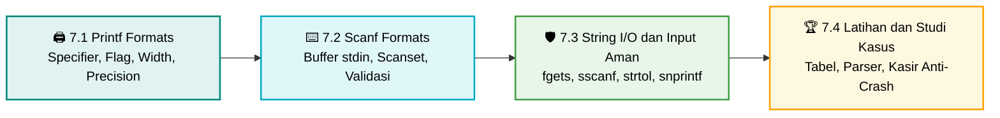

<div align="center">


### Praktikum Konsep Pemrograman · S1 Informatika UNS

[](#)
[](#)
[](#)
[](#)

<br>

[📋 Kembali ke Daftar Materi Utama](../Daftar_Materi.md) &nbsp;•&nbsp; [Mulai Belajar Modul 7.1 ➡️](01-Printf-Formats.md)

---

</div>

## 📺 Mengapa Formatted I/O Itu Penting?

Sejak hari pertama belajar bahasa C, dua fungsi yang paling sering kamu ketik adalah `printf()` dan `scanf()`. Namun sebagian besar pemula hanya memakainya untuk hal sederhana:

```c
printf("Nilai Anda: %d\n", nilai);
scanf("%d", &angka);
```

Di dunia nyata, program tidak hanya harus berjalan benar, tetapi juga harus **berkomunikasi dengan manusia secara rapi, elegan, dan aman**. Pernahkah kamu bertanya:

- Bagaimana mencetak **tabel laporan atau struk kasir** dengan kolom sejajar tanpa menghitung spasi secara manual?
- Bagaimana membatasi desimal agar tercetak rapi dua angka di belakang koma (`Rp 15000.50`)?
- Bagaimana mencetak heksadesimal dengan padding nol (`0x00FF`) seperti kode warna atau alamat memori?
- Mengapa `scanf("%c")` sering tiba-tiba terlewati tanpa sempat kita mengetik apa pun?
- Bagaimana membaca teks **berspasi** (nama lengkap, alamat) tanpa *buffer overflow*?
- Mengapa program bisa berputar tanpa henti ketika pengguna mengetik huruf pada input angka?

Semua jawabannya ada di **Bab 7: Formatted I/O**.

---

## 🧰 Persiapan Sebelum Mulai

- Compiler C (GCC/Clang). Disarankan Linux, macOS, atau Windows dengan MinGW/WSL.
- Kompilasi semua contoh dengan peringatan aktif:

  ```bash
  gcc -std=c99 -Wall -Wextra -o program program.c
  ```

- Pengetahuan prasyarat: variabel dan tipe data dasar, percabangan, perulangan, array `char`, serta pengenalan pointer dari Bab 6.
- Jika terminalmu menampilkan karakter aneh untuk emoji atau simbol Unicode, gunakan teks biasa seperti `[OK]` dan `[!]` pada program. Contoh kode di bab ini sengaja memakai teks biasa agar aman di semua terminal.

---

## ⚠️ Miskonsepsi & Jebakan Umum di Bab 7

1. **"Flag `-` pada `printf` untuk rata kanan"** ❌
   **Fakta:** Terbalik. Default `printf` adalah rata kanan; flag `-` mengubahnya menjadi **rata kiri**.
2. **"`scanf("%s", str)` aman untuk membaca string"** ❌
   **Fakta:** `%s` berhenti di spasi pertama dan, tanpa batas lebar, bisa meluap melebihi array (**buffer overflow**). Gunakan `%19s`. Namun field width saja belum cukup: kelebihan input tetap tertinggal di buffer dan harus dibuang.
3. **"`scanf("%c")` sering dilewati karena compiler bug"** ❌
   **Fakta:** Bukan bug. `\n` dari Enter sebelumnya masih ada di `stdin` dan langsung dibaca oleh `%c`. Solusinya `scanf(" %c", &ch)`.
4. **"Semua variabel pada `scanf` harus pakai `&`"** ❌
   **Fakta:** Variabel tunggal (`int`, `double`, `char`) butuh `&`. Nama array `char` sudah berupa alamat, dan `&nama_array` bahkan bertipe berbeda (`char (*)[N]`) sehingga tidak cocok dengan `%s`.
5. **"`scanf` tidak punya nilai kembalian"** ❌
   **Fakta:** `scanf` mengembalikan jumlah item yang berhasil dibaca, atau `EOF` jika input habis. Mengabaikan nilai ini adalah sumber *infinite loop* dan variabel berisi sampah.
6. **"`%f` dan `%lf` sama saja"** ❌
   **Fakta:** Pada `printf` memang setara, tetapi pada `scanf` **tidak**. Variabel `double` wajib dibaca dengan `%lf`.
7. **"Format yang salah hanya menghasilkan output aneh"** ❌
   **Fakta:** Specifier yang tidak cocok dengan argumen adalah *undefined behavior*, yang bisa berujung crash. Dan `printf(input_pengguna)` adalah celah keamanan (*format string vulnerability*).
8. **"`while (getchar() != '\n');` aman dipakai untuk membersihkan buffer"** ❌
   **Fakta:** Jika input habis (EOF), loop ini berputar selamanya. Selalu tambahkan pengecekan `c != EOF`.

---

## 🗺️ Roadmap Pembelajaran Bab 7



---

## 🎯 Capaian Pembelajaran

Setelah menyelesaikan Bab 7, kamu diharapkan mampu:

- [x] **Menguasai format specifier:** memakai `%d`, `%u`, `%f`, `%e`, `%g`, `%x`, `%o`, `%p`, `%s`, `%c`, serta length modifier (`l`, `ll`, `z`) dengan tipe argumen yang benar.
- [x] **Memformat layout keluaran:** mengatur width, precision, flag (`-`, `+`, `0`, `#`, spasi), dan wildcard `*` untuk tabel rapi dan teks rata tengah.
- [x] **Memahami buffer `stdin`:** menjelaskan bagaimana `scanf` mengonsumsi karakter dan mengapa sisa input menimbulkan bug.
- [x] **Memilih specifier `scanf` dengan benar:** membedakan `%f`/`%lf`, `%d`/`%i`, dan kapan memakai `&`.
- [x] **Mencegah jebakan input:** menghindari newline trap, buffer overflow, dan infinite loop (termasuk saat EOF).
- [x] **Memakai scanset dan suppression:** membaca teks berspasi dan mem-parsing input berformat.
- [x] **Menerapkan input aman:** `fgets` + `sscanf`/`strtol`, merakit string dengan `snprintf`, dan memisahkan `stderr`.
- [x] **Menghindari celah format string** dan *undefined behavior* akibat specifier yang tidak cocok.

---

## 📑 Modul Pembelajaran

| Modul | Topik & Tautan | Pokok Bahasan Utama | Estimasi |
|:---:|:---|:---|:---:|
| **7.1** | [🖨️ **Printf Formats**](01-Printf-Formats.md) | Anatomi specifier, tabel specifier, flag, width, precision, wildcard `*`, length modifier, heksa berpadding, return value, *undefined behavior*, format string vulnerability, studi kasus struk kasir. | ⏱️ 35 Menit |
| **7.2** | [⌨️ **Scanf Formats**](02-Scanf-Formats.md) | Mekanisme `stdin`, tabel specifier `scanf` (`%f` vs `%lf`), operator `&`, return value dan `EOF`, field width, aturan whitespace, suppression, scanset, jebakan newline dan infinite loop, studi kasus form registrasi. | ⏱️ 40 Menit |
| **7.3** | [🛡️ **String I/O & Input Aman**](03-String-IO-dan-Input-Aman.md) | `fgets`, `sscanf`, `strtol`/`strtod`, pustaka mini input aman, `snprintf`, `stdout` vs `stderr`, ringkasan keamanan. | ⏱️ 35 Menit |
| **7.4** | [🏆 **Latihan & Studi Kasus**](04-Latihan-dan-Studi-Kasus.md) | Cheatsheet, soal bertingkat (tabel nilai, multi-base, tebak output, rata tengah, parser waktu, ghost enter, bug `double`, format string, kasir toko buku, parser CSV), kunci solusi & pembahasan. | ⏱️ 50 Menit |

**Total estimasi: ±2,7 jam** (termasuk praktik langsung di compiler)

---

<div align="center">

[⬅️ Kembali ke Bab 6: Pointer](../bab-06-pointer/Bab6-Overview.md) &nbsp;&nbsp;|&nbsp;&nbsp; [Mulai Modul 7.1: Printf Formats ➡️](01-Printf-Formats.md)

</div>
