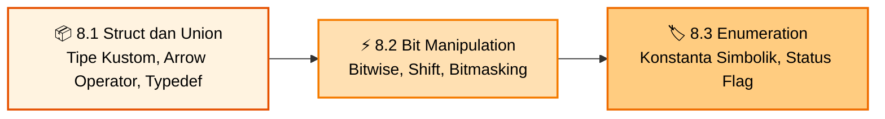

<div align="center">


### Praktikum Konsep Pemrograman · S1 Informatika UNS

[](#)
[](#)
[](#)
[](#)

<br>

[📋 Kembali ke Daftar Materi Utama](../Daftar_Materi.md) &nbsp;•&nbsp; [Mulai Belajar Modul 8.1 ➡️](01-Struct-dan-Union.md)

---

</div>

## 🚀 Mengapa Mempelajari Topik C Lanjutan?

Setelah menguasai pointer dan masukan/keluaran berformat di Bab 6 dan 7, saatnya melangkah lebih jauh ke fitur-fitur bahasa C yang mendekatkan kita pada arsitektur sistem dan desain data modern:

1. **Struct (Struktur Data Heterogen):** Dalam program nyata, sebuah entitas (misalnya mahasiswa, barang inventaris, atau karakter game) memiliki banyak atribut dengan berbagai tipe data berbeda. Struct memungkinkan kita mengelompokkan variabel-variabel tersebut menjadi satu kesatuan tipe data kustom yang utuh.
2. **Union (Memori Bersama):** Di lingkungan dengan sumber daya terbatas (seperti sistem embedded atau protokol jaringan), Union memungkinkan beberapa variabel berbagi alamat memori yang persis sama untuk menghemat ruang.
3. **Bit Manipulation (Operasi Tingkat Rendah):** Beroperasi langsung pada level bit (0 dan 1) menggunakan operator bitwise dan shift. Sangat krusial untuk bitmasking, flag status, kriptografi, kompresi data, dan komunikasi periferal perangkat keras.
4. **Enumeration (Enum):** Menghilangkan *magic numbers* dalam kode dengan menggantinya menjadi nama simbolik yang mudah dibaca dan dikelola.

---

## 🧰 Persiapan & Prasyarat Sebelum Mulai

- Pemahaman tipe data primitif, array, dan string.
- Pemahaman pointer (operator `*` dan `&`, serta akses alamat memori dari Bab 6).
- Kompilasi semua program contoh menggunakan compiler standar:

  ```bash
  gcc -std=c99 -Wall -Wextra -o program program.c
  ```

---

## ⚠️ Miskonsepsi & Jebakan Umum di Bab 8

1. **"Ukuran struct adalah jumlah eksak dari ukuran setiap anggotanya"** ❌  
   **Fakta:** Compiler menerapkan *memory alignment* dan menyisipkan *padding bytes* agar pengaksesan data oleh CPU lebih efisien. Akibatnya, `sizeof(struct)` seringkali lebih besar daripada jumlah ukuran anggotanya.
2. **"Struct di C otomatis pass-by-reference"** ❌  
   **Fakta:** Bahasa C selalu *pass-by-value*. Mengirim struct langsung ke fungsi akan menyalin seluruh datanya ke stack. Untuk efisiensi, gunakan pointer ke struct (`const MyStruct *ptr`) bersama operator panah (`->`).
3. **"Union dapat menyimpan semua anggotanya secara bersamaan"** ❌  
   **Fakta:** Semua anggota union menempati lokasi memori yang sama. Mengubah salah satu anggota akan menimpa nilai anggota lainnya. Hanya satu anggota yang bernilai valid pada satu waktu.
4. **"Bitwise operator (`&`, `|`) sama dengan Logical operator (`&&`, `||`)"** ❌  
   **Fakta:** Operator logika menghasilkan `0` atau `1` dan mendukung *short-circuit evaluation*. Operator bitwise beroperasi pada setiap pasangan bit individual di level biner tanpa short-circuit.
5. **"Enum adalah string / teks"** ❌  
   **Fakta:** Dalam bahasa C, elemen enum secara internal adalah konstanta bilangan bulat (`int`). Menampilkan nilai enum dengan `printf("%s")` akan menimbulkan undefined behavior/crash; gunakan `%d`.

---

## 🗺️ Roadmap Pembelajaran Bab 8



---

## 🎯 Capaian Pembelajaran

Setelah menyelesaikan Bab 8, kamu diharapkan mampu:

- [x] **Mendeklarasikan dan Menggunakan Struct:** Merancang tipe data baru yang menggabungkan berbagai tipe data primitif dan array.
- [x] **Mengakses Anggota Struct:** Menggunakan operator titik (`.`) untuk variabel struct dan operator panah (`->`) untuk pointer struct.
- [x] **Menerapkan Type Aliasing:** Menggunakan `typedef` untuk menyederhanakan penulisan tipe data struct dan union.
- [x] **Memahami Mekanisme Union:** Memanfaatkan union untuk skenario memori bersama dan *variant types*.
- [x] **Menguasai Operasi Bitwise:** Menerapkan AND (`&`), OR (`|`), XOR (`^`), NOT (`~`), Right Shift (`>>`), dan Left Shift (`<<`).
- [x] **Mengimplementasikan Enumerasi:** Menggunakan `enum` untuk membuat status kode, menu aplikasi, dan konfigurasi yang rapi dan bebas *magic number*.

---

## 📑 Modul Pembelajaran

| Modul | Topik & Tautan | Pokok Bahasan Utama | Estimasi |
|:---:|:---|:---|:---:|
| **8.1** | [📦 **Struct dan Union**](01-Struct-dan-Union.md) | Deklarasi, definisi, inisialisasi, assignment, akses field (`.` dan `->`), pointer to struct, array of struct, konsep union, dan `typedef`. | ⏱️ 45 Menit |
| **8.2** | [⚡ **Bit Manipulation**](02-Bit-Manipulation.md) | Konsep biner di memori, fungsi cetak biner, operator bitwise (`&`, `\|`, `^`, `~`), operator shift (`<<`, `>>`), dan bitmasking. | ⏱️ 35 Menit |
| **8.3** | [🏷️ **Enumeration**](03-Enumeration.md) | Konsep enum, deklarasi/definisi, nilai default vs manual, penggunaan switch-case dengan enum, dan perbandingan efisiensi memori. | ⏱️ 25 Menit |

**Total estimasi: ±1,8 jam** (termasuk praktik langsung di compiler)

---

<div align="center">

[⬅️ Kembali ke Bab 7: Formatted I/O](../bab-07-formatted-io/Bab7-Overview.md) &nbsp;&nbsp;|&nbsp;&nbsp; [Mulai Modul 8.1: Struct dan Union ➡️](01-Struct-dan-Union.md)

</div>

