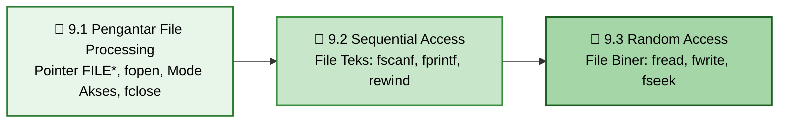

### Praktikum Konsep Pemrograman · S1 Informatika UNS

 

[📋 Kembali ke Daftar Materi Utama](../Daftar_Materi.md) &nbsp;•&nbsp; [Mulai Belajar Modul 9.1 ➡️](01-Pengantar-File-Processing.md)

---

## 💾 Mengapa File Processing Sangat Penting?

Selama ini seluruh program yang kita buat menyimpan data di **RAM (Random Access Memory)**. RAM bersifat **volatile** — begitu program berhenti, terminal ditutup, atau komputer mati, seluruh data variabel akan lenyap selamanya.

Di dunia industri dan pembuatan aplikasi nyata, program membutuhkan **persistensi data**:
- **Menyimpan kemajuan game (*save game / checkpoint*).**
- **Menyimpan dan memuat konfigurasi (*settings.json / config.dat*).**
- **Mencatat log aktivitas server atau sistem (*app.log*).**
- **Menyimpan database inventaris, rekam medis, atau perbankan.**

Seluruh kemampuan ini diimplementasikan melalui **File Processing** (atau **File Handling**) menggunakan pustaka standar C `<stdio.h>`.

---

## ⚠️ Miskonsepsi & Jebakan Umum di Bab 9

1. **"Tidak mengecek apakah file berhasil dibuka"** ❌  
   **Fakta:** Jika path file salah atau izin akses ditolak, `fopen()` mengembalikan pointer `NULL`. Memanggil fungsi baca/tulis pada pointer `NULL` akan menyebabkan program **crash (Segmentation Fault)** seketika. Selalu cek `if (file != NULL)`.
2. **"Lupa menutup file dengan `fclose()`"** ❌  
   **Fakta:** Sistem operasi membatasi jumlah file yang dapat dibuka bersamaan (*file descriptor leak*). Selain itu, C menggunakan *buffer I/O* — data baru benar-benar ditulis ke disk saat buffer penuh atau saat `fclose()` dipanggil. Lupa menutup file bisa membuat file hasil akhir berukuran 0 byte atau rusak.
3. **"Mode `'w'` aman dipakai untuk menambah data"** ❌  
   **Fakta:** Membuka file yang sudah ada dengan mode `"w"` akan memotong panjang file menjadi 0 byte (*truncate*) dan menghapus seluruh isi data lama. Untuk menambah data di baris paling belakang, gunakan mode `"a"` (*append*).
4. **"Mode teks dan biner sama saja di semua sistem operasi"** ❌  
   **Fakta:** Di Windows, mode teks secara otomatis mengubah karakter newline `\n` menjadi `\r\n`. Jika file biner dibuka dalam mode teks, konversi ini akan merusak data byte biner. Selalu tambahkan huruf `b` (seperti `"rb"`, `"wb"`) untuk file biner.
5. **"`feof()` mengecek akhir file sebelum operasi baca"** ❌  
   **Fakta:** `feof()` baru bernilai *true* **setelah** ada upaya pembacaan yang gagal melewati batas akhir file. Menulis `while (!feof(f))` sering menyebabkan data terakhir terbaca dua kali.
6. **"Menulis struct yang berisi pointer langsung menggunakan `fwrite`"** ❌  
   **Fakta:** `fwrite` hanya menulis alamat hexadecimal pointer di RAM saat itu. Alamat tersebut tidak akan valid lagi saat program dijalankan kembali di lain waktu. Struct yang disimpan ke file biner harus berupa data mandiri (*flat structure* tanpa pointer dinamis).

---

## 🗺️ Roadmap Pembelajaran Bab 9

---

## 🎯 Capaian Pembelajaran

Setelah menyelesaikan Bab 9, kamu diharapkan mampu:

- [x] **Memahami Struktur `FILE`:** Menjelaskan peran pointer `FILE *` sebagai pengendali *stream* I/O file.
- [x] **Membuka dan Menutup File dengan Aman:** Menggunakan `fopen()` dengan mode yang sesuai (`r`, `w`, `a`, `rb`, `wb`, `ab`) dan selalu menangani pointer `NULL` serta memanggil `fclose()`.
- [x] **Menguasai Sequential Access (File Teks):** Membaca data menggunakan `fscanf()` / `fgets()` dan menulis data menggunakan `fprintf()`.
- [x] **Menguasai Random Access (File Biner):** Menyimpan dan memuat array serta struct utuh ke file biner menggunakan `fread()` dan `fwrite()`.
- [x] **Navigasi Pointer File:** Mengatur posisi kursor baca/tulis menggunakan `rewind()` dan `fseek()` dengan `SEEK_SET`, `SEEK_CUR`, serta `SEEK_END`.

---

## 📑 Modul Pembelajaran

| Modul | Topik & Tautan | Pokok Bahasan Utama | Estimasi |
|:---:|:---|:---|:---:|
| **9.1** | [📑 **Pengantar File Processing**](01-Pengantar-File-Processing.md) | Representasi `FILE *`, tabel mode akses teks vs biner, mekanisme `fopen()` dan `fclose()`, serta penanganan error pointer NULL. | ⏱️ 30 Menit |
| **9.2** | [📝 **Sequential Access**](02-Sequential-Access.md) | Konsep file plaintext, pembacaan terstruktur dengan `fscanf`, penulisan dengan `fprintf`, dan mereset kursor dengan `rewind()`. | ⏱️ 35 Menit |
| **9.3** | [💾 **Random Access**](03-Random-Access.md) | Konsep file binary, pembacaan blok (`fread`), penulisan blok (`fwrite`), baca/tulis array dinamis dan struct, serta navigasi offset acak dengan `fseek`. | ⏱️ 45 Menit |

**Total estimasi: ±1,8 jam** (termasuk praktik langsung di compiler)

---

[⬅️ Kembali ke Bab 8: Topik C Lanjutan](../bab-08-topik-c-lanjutan/Bab8-Overview.md) &nbsp;&nbsp;|&nbsp;&nbsp; [Mulai Modul 9.1: Pengantar File Processing ➡️](01-Pengantar-File-Processing.md)

