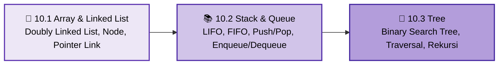

<div align="center">


### Praktikum Konsep Pemrograman · S1 Informatika UNS

[](#)
[](#)
[](#)
[](#)

<br>

[📋 Kembali ke Daftar Materi Utama](../Daftar_Materi.md) &nbsp;•&nbsp; [Mulai Belajar Modul 10.1 ➡️](1-ArrayLinkedList.md)

---

</div>

## 🏗️ Mengapa Mempelajari Struktur Data?

Setelah menguasai pointer, manipulasi memori dinamis, struct, dan pengolahan file pada bab-bab sebelumnya, langkah krusial berikutnya adalah memahami bagaimana data diorganisasikan secara efisien di dalam memori program.

Dalam rekayasa perangkat lunak, pemilihan struktur data yang tepat menentukan efisiensi dan skalabilitas aplikasi:

1. **Array vs Linked List:** Array menyimpan data secara bersebelahan (*contiguous*) dengan akses instan melalui indeks $O(1)$, namun berukuran kaku dan membutuhkan pergeseran elemen saat penambahan/penghapusan. Sebaliknya, **Linked List** menghubungkan node-node di memori terpisah menggunakan pointer, menawarkan fleksibilitas penambahan dan penghapusan tanpa batas ukuran awal.
2. **Stack (Tumpukan / LIFO):** Membatasi akses sehingga elemen terakhir yang masuk adalah yang pertama keluar (*Last In, First Out*). Pola ini mendasari fitur undo/redo aplikasi, evaluasi parsing ekspresi aritmatika, hingga mekanisme pemanggilan fungsi (*call stack*) di dalam sistem operasi.
3. **Queue (Antrean / FIFO):** Mengatur akses agar elemen pertama yang masuk menjadi yang pertama dilayani (*First In, First Out*). Esensial untuk antrean pencetakan dokumen, sistem transfer pesan, penjadwalan antrean CPU (*task scheduling*), serta algoritma penjelajahan graf (*BFS*).
4. **Tree & Binary Search Tree (BST):** Membawa kita keluar dari data linear menuju representasi hierarkis non-linear. Binary Search Tree memungkinkan operasi pencarian, penambahan, dan penghapusan data berlangsung sangat cepat dalam waktu logaritmik $O(\log n)$ dengan menjaga elemen selalu terurut.

---

## 🧰 Persiapan & Prasyarat Sebelum Mulai

- Pemahaman mendalam tentang **Pointer** (operator dereference `*`, operator alamat `&`, serta konsep pointer ke pointer `**` dari Bab 6).
- Penguasaan alokasi memori dinamis menggunakan `malloc()` dan `free()` dari Bab 6.
- Pemahaman tentang tipe data bentukan **Struct** dari Bab 8.
- Pemahaman logika **Rekursi** dari Bab 4 untuk menelusuri dan memanipulasi struktur pohon (*tree*).
- Kompilasi seluruh latihan dan contoh kode dengan flag peringatan compiler aktif:

  ```bash
  gcc -std=c99 -Wall -Wextra -o program program.c
  ```

---

## ⚠️ Miskonsepsi & Jebakan Umum di Bab 10

1. **"Kebocoran Memori (*Memory Leak*) karena lupa `free()`"** ❌  
   **Fakta:** Setiap pemanggilan `malloc()` wajib diimbangi dengan `free()`. Pada struktur data berkait seperti linked list dan tree, seluruh node harus dibebaskan secara teratur (misalnya traversal post-order pada tree) agar pointer ke elemen berikutnya tidak hilang sebelum sempat dibebaskan.
2. **"Mengakses pointer yang sudah dibebaskan (*Dangling Pointer*)"** ❌  
   **Fakta:** Membaca atau mengakses `iterator->next` setelah baris `free(iterator)` akan mengakses memori yang tidak valid. Simpan selalu pointer berikutnya ke dalam variabel sementara sebelum memanggil `free()`.
3. **"Lupa memperbarui kedua arah pada Doubly Linked List"** ❌  
   **Fakta:** Pada doubly linked list, pointer `next` dan `prev` harus diperbarui secara konsisten di kedua sisi. Jika salah satu sisi tertinggal, rantai list akan rusak atau terputus saat ditelusuri mundur.
4. **"Mencampur aturan akses Stack dan Queue"** ❌  
   **Fakta:** Stack hanya beroperasi pada satu ujung puncaknya (*top/last*), sedangkan queue menambah di ujung belakang (*last*) dan mengeluarkan dari ujung depan (*first*). Mengubah sisi operasi secara acak akan merusak prinsip LIFO/FIFO.
5. **"Menganggap BST valid hanya karena anak kiri < root < anak kanan"** ❌  
   **Fakta:** Aturan BST berlaku untuk **seluruh subtree**, bukan hanya anak langsung. Seluruh node di seluruh subtree kiri harus lebih kecil dari root, dan seluruh node di subtree kanan harus lebih besar dari root.
6. **"Menghapus node BST beranak dua tanpa mencari Successor"** ❌  
   **Fakta:** Node dengan dua anak tidak boleh dihapus langsung karena dapat memutus rantai subtree. Gunakan *in-order successor* (nilai terkecil di subtree kanan) untuk menggantikan nilai node tersebut sebelum menghapus node penggantinya.

---

## 🗺️ Roadmap Pembelajaran Bab 10



---

## 🎯 Capaian Pembelajaran

Setelah menyelesaikan Bab 10, kamu diharapkan mampu:

- [x] **Membedakan Karakteristik Array & Linked List:** Menjelaskan perbedaan penyimpanan sekuensial di memori dan implikasi kompleksitas waktunya.
- [x] **Mengimplementasikan Doubly Linked List:** Membangun struktur list lengkap dengan operasi inisialisasi, penambahan node, pencarian, penghapusan, dan pembersihan memori.
- [x] **Menerapkan Stack (LIFO) & Queue (FIFO):** Mengabstraksi linked list menjadi struktur data beraturan khusus dengan operasi berkinerja $O(1)$.
- [x] **Memahami Struktur Hirarkis & Tree:** Mengenal terminologi root, child, parent, leaf, level, height, serta membedakan binary tree dan BST.
- [x] **Menguasai Binary Search Tree (BST):** Mengimplementasikan algoritma insersi, pencarian nilai/kunci, penelusuran (Pre-Order, In-Order, Post-Order), dan penghapusan node pada ketiga kasus.
- [x] **Mencegah Masalah Memori & Pointer:** Menghindari *memory leak*, *dangling pointer*, dan pemutusan relasi pointer pada struktur data dinamis.

---

## 📑 Modul Pembelajaran

| Modul | Topik & Tautan | Pokok Bahasan Utama | Estimasi |
|:---:|:---|:---|:---:|
| **10.1** | [🔗 **Array dan Linked List**](1-ArrayLinkedList.md) | Perbandingan array vs linked list di memori, pembentukan doubly linked list (`first`, `last`, `prev`, `next`), operasi `insertWeapon`, `deleteWeapon`, traversal maju/mundur, dan manajemen alokasi memori dinamis. | ⏱️ 45 Menit |
| **10.2** | [📚 **Stack dan Queue**](2-StackQueue.md) | Konsep dan prinsip LIFO serta FIFO, implementasi operasi `push`, `pop`, `top`, `enqueue`, `dequeue`, `head`, analisis kompleksitas waktu $O(1)$, dan pencegahan error pointer NULL. | ⏱️ 35 Menit |
| **10.3** | [🌳 **Tree**](3-Tree.md) | Anatomi pohon, karakteristik Binary Search Tree (BST), operasi insersi rekursif, pencarian kunci, traversal (Pre-Order, In-Order, Post-Order), penanganan 3 kasus delesi, dan pointer ke pointer (`**`). | ⏱️ 55 Menit |

**Total estimasi: ±2,2 jam** (termasuk praktik langsung di compiler)

---

<div align="center">

[⬅️ Kembali ke Bab 9: File Processing](../bab-09-file-processing/Bab9-Overview.md) &nbsp;&nbsp;|&nbsp;&nbsp; [Mulai Modul 10.1: Array dan Linked List ➡️](1-ArrayLinkedList.md)

</div>

