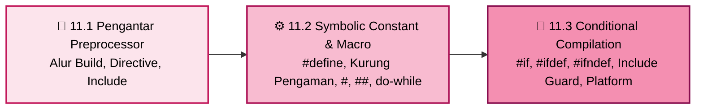

<div align="center">


### Praktikum Konsep Pemrograman · S1 Informatika UNS

[](#)
[](#)
[](#)
[](#)

<br>

[📋 Kembali ke Daftar Materi Utama](../Daftar_Materi.md) &nbsp;•&nbsp; [Mulai Belajar Modul 11.1 ➡️](Bab-11-Bagian-1-Pengantar-dan-Macro.md)

---

</div>

## ⚙️ Mengapa Mempelajari Preprocessor?

Saat kita memprogram dalam bahasa C, kode yang kita tulis tidak langsung diterjemahkan menjadi bahasa mesin. Sebelum tahap kompilasi yang sesungguhnya berlangsung, ada satu tahap krusial bernama **preprocessing**.

Preprocessor bekerja sebagai pemroses teks cerdas yang menyiapkan *source code* agar siap diterima oleh compiler. Memahami preprocessor membuka berbagai kemampuan tingkat lanjut dalam rekayasa perangkat lunak C:

1. **Otomatisasi Teks & Konstanta Simbolik:** Menghilangkan *magic numbers* menggunakan `#define`, serta merangkai string dan token secara otomatis dengan operator `#` dan `##`.
2. **Function-Like Macro:** Menyediakan abstraksi fungsi mini yang dievaluasi secara instan (*inline*) tanpa *overhead* pemanggilan fungsi pada *call stack*.
3. **Kompilasi Kondisional (*Conditional Compilation*):** Memilah blok kode mana yang akan dikompilasi berdasarkan kondisi tertentu, seperti target sistem operasi (Windows, Linux, macOS), arsitektur mesin, atau mode kompilasi (*debug* vs *release*).
4. **Manajemen Header & Modul:** Menggunakan mekanisme *include guard* (`#ifndef` ... `#define` ... `#endif`) untuk mencegah deklarasi ganda dan dependensi sirkular saat proyek memiliki banyak berkas modul.

---

## 🧰 Persiapan & Prasyarat Sebelum Mulai

- Pemahaman dasar sintaks C (variabel, tipe data, operator, percabangan, fungsi, dan struct).
- Untuk melihat hasil kerja preprocessor secara nyata, gunakan opsi `-E` pada compiler GCC/Clang:

  ```bash
  gcc -E source.c -o source.i
  ```

  Berkas `source.i` berisi kode C murni setelah semua directive `#include` disisipkan dan seluruh macro digantikan nilainya.
- Kompilasi program contoh dengan peringatan compiler aktif:

  ```bash
  gcc -std=c99 -Wall -Wextra -o program program.c
  ```

---

## ⚠️ Miskonsepsi & Jebakan Umum di Bab 11

1. **"Preprocessor memeriksa tipe data dan aturan sintaks C"** ❌  
   **Fakta:** Preprocessor hanya melakukan manipulasi teks murni (substitusi string). Preprocessor tidak memahami tipe data, semantik ekspresi, atau aturan scope variabel.
2. **"Macro tidak memerlukan tanda kurung pelindung"** ❌  
   **Fakta:** Tanpa tanda kurung pengaman pada argumen dan hasil ekspresi (seperti `((a) * (b))`), aturan prioritas operator (*precedence*) dapat mengubah urutan operasi matematika dan menimbulkan bug tersembunyi.
3. **"Aman menggunakan operator *increment* (`++`/`--`) pada argumen macro"** ❌  
   **Fakta:** Jika argumen yang dikirim memiliki efek samping (*side-effect*) dan dipakai lebih dari satu kali di dalam badan macro (misalnya `MAX(a, b)`), ekspresi tersebut akan dievaluasi ganda sehingga nilainya bertambah lebih dari yang diharapkan.
4. **"Mengakhiri baris directive `#define` dengan titik koma (`;`)"** ❌  
   **Fakta:** Directive preprocessor tidak menggunakan titik koma di akhir baris. Menambahkan `;` pada `#define ANGKA 10;` akan menyebabkan tanda titik koma ikut tersubstitusi ke kode dan memicu kesalahan kompilasi.
5. **"`#if` bisa mengecek nilai variabel program"** ❌  
   **Fakta:** Variabel program baru memiliki nilai saat program berjalan (*runtime*). Kompilasi kondisional (`#if`) hanya dapat mengevaluasi ekspresi konstanta atau macro yang sudah terdefinisi saat preprocessing.
6. **"Lupa menutup `#if`, `#ifdef`, atau `#ifndef` dengan `#endif`"** ❌  
   **Fakta:** Setiap pembuka directive kondisional wajib berpasangan dengan `#endif`. Kehilangan penutup `#endif` akan memicu error kompilasi fatal di akhir berkas (*unterminated #ifdef*).

---

## 🗺️ Roadmap Pembelajaran Bab 11



---

## 🎯 Capaian Pembelajaran

Setelah menyelesaikan Bab 11, kamu diharapkan mampu:

- [x] **Memahami Peran Preprocessor:** Menjelaskan posisi preprocessor dalam tahapan build bahasa C dan memanfaatkan opsi `gcc -E`.
- [x] **Menguasai Directive `#include`:** Membedakan pencarian berkas `<header.h>` sistem dan `"header.h"` lokal.
- [x] **Mendefinisikan Konstanta Simbolik & Macro:** Menulis konstanta dan macro fungsi yang aman dari jebakan *precedence* dan efek samping.
- [x] **Menggunakan Operator Preprocessor:** Menerapkan operator perangkai string (`#`), penggabung token (`##`), dan idiom multiline `do { ... } while(0)`.
- [x] **Menerapkan Conditional Compilation:** Menggunakan `#if`, `#ifdef`, `#ifndef`, `#elif`, `#else`, dan `#endif` untuk kode lintas platform dan penanganan debug log.
- [x] **Membangun Include Guard:** Mencegah deklarasi ganda pada berkas header proyek C.

---

## 📑 Modul Pembelajaran

| Modul | Topik & Tautan | Pokok Bahasan Utama | Estimasi |
|:---:|:---|:---|:---:|
| **11.1 & 11.2** | [📑 **Pengantar Preprocessor & Macro**](Bab-11-Bagian-1-Pengantar-dan-Macro.md) | Alur build C, opsi `gcc -E`, directive dasar, konstanta simbolik `#define`, function-like macro, jebakan tanda kurung & efek samping, operator `#` dan `##`, multiline macro `do-while(0)`, serta predefined macro bawaan C. | ⏱️ 45 Menit |
| **11.3** | [🔀 **Conditional Compilation**](Bab-11-Bagian-2-Conditional-Compilation.md) | Konsep kompilasi kondisional, directive `#if`, `#ifdef`, `#ifndef`, `#elif`, `#else`, `#endif`, operator `defined`, implementasi *include guard*, kompilasi multiplatform, serta directive `#error` dan `#warning`. | ⏱️ 40 Menit |

**Total estimasi: ±1,5 jam** (termasuk praktik langsung di compiler)

---

<div align="center">

[⬅️ Kembali ke Bab 10: Struktur Data](../bab-10-struktur-data/Bab10-Overview.md) &nbsp;&nbsp;|&nbsp;&nbsp; [Mulai Modul 11.1: Pengantar Preprocessor & Macro ➡️](Bab-11-Bagian-1-Pengantar-dan-Macro.md)

</div>
